# ZeroOne 壁纸应用 · 项目架构

> 适用读者：不熟悉本项目的人也能看懂模块关系。
> 最后同步：2026-09-12（与代码实际状态一致；7 个无调用方的历史文件已于同日删除，见 `CHANGELOG.md`）。

## 一、整体结构

```mermaid
flowchart TB
    classDef page    fill:#e3f2fd,stroke:#1565c0,stroke-width:2px,color:#0d47a1
    classDef overlay fill:#fff8e1,stroke:#f57c00,stroke-width:2px,color:#e65100
    classDef data    fill:#e8f5e9,stroke:#2e7d32,stroke-width:2px,color:#1b5e20
    classDef mech    fill:#f3e5f5,stroke:#6a1b9a,stroke-width:2px,color:#4a148c
    classDef cloud   fill:#eceff1,stroke:#546e7a,color:#263238

    subgraph ENTRY["entry 模块（唯一模块）"]
        ability["EntryAbility 应用入口"]

        subgraph PAGES["页面层 pages/"]
            idx["Index.ets — 4 个 Tab（首页/合辑/贴纸/我的）"]
            home["HomePage — Cuto 式大图卡片流"]
            cat["CategoryPage — 合辑墙 + 详情网格"]
            sticker["StickerPage — 贴纸枢纽"]
            mine["MinePage — 商城介绍 + 收藏 + 帮助 + 法律与关于"]
        end

        subgraph OVERLAYS["覆盖层（叠在 Index 之上）"]
            prev["ImagePreview — 全屏大图预览（缩放/下滑关闭/锁屏桌面模拟）"]
            editor["ImageEditor — 旋转/裁剪/滤镜/纹理/文字/贴纸"]
            studio["StickerStudioPage — 贴纸工作台（选背景 → 合成）"]
            board["StickerBoardPage — 多贴纸画板"]
            guide["SetWallpaperGuidePanel — 设为壁纸引导"]
            legal["LegalDocPage — 隐私政策/用户协议/关于"]
        end

        subgraph DATA["数据层"]
            store["WallpaperStore — 唯一数据源（AppStorage 状态键 + 本地缓存 + 分页 + retry）"]
            prefs["PreferenceUtil — 收藏/字符串 KV（favoriteIds 广播）"]
            clouddb["CloudDBUtil — 云数据库查询/分页/播种"]
        end

        subgraph MECH["横切机制"]
            pixel["PixelScope — PixelMap 生命周期作用域"]
            guard["EditGuard — 返回键拦截 + 放弃编辑确认"]
            appinfo["AppInfo — 版本号"]
        end

        subgraph EDITOR["编辑器内核 common/editor/"]
            composer["ImageComposer — 离屏合成导出（WYSIWYG）"]
            filtertask["FilterTask — 滤镜/纹理 @Concurrent（TaskPool）"]
            geom["CropGeometry / LayerGeometry — 纯几何换算"]
        end

    end

    subgraph AGC["华为 AGC"]
        cdb["云数据库 zone=zeroone / 对象类型 wallpapers"]
    end

    ability --> idx
    idx --> home
    idx --> cat
    idx --> sticker
    idx --> mine
    sticker --> studio
    sticker --> board
    home --> prev
    cat --> prev
    mine --> prev
    mine --> legal
    prev --> editor
    prev --> guide
    home --> store
    cat --> store
    mine --> store
    store --> clouddb
    store --> prefs
    clouddb --> cdb
    editor --> composer
    editor --> filtertask
    editor --> geom
    editor --> pixel
    studio --> pixel
    board --> pixel
    prev --> guard
    editor --> guard
    studio --> guard
    board --> guard
    legal --> guard
    mine --> appinfo
    legal --> appinfo

    class idx,home,cat,sticker,mine page
    class prev,editor,studio,board,guide,legal overlay
    class store,prefs,clouddb data
    class pixel,guard,appinfo,composer,filtertask,geom mech
    class cdb cloud
```



## 二、横切机制（改代码前必读）

这些机制是为了修掉"同类问题反复出现"而抽出来的，**新增功能请复用，不要各写一份**。

| 机制 | 文件 | 解决什么 | 使用要点 |
|---|---|---|---|
| **资源作用域** | `common/utils/PixelScope.ets` | PixelMap/ImagePacker 是 Native 资源，GC 不回收，不 `release()` 必 OOM | 会持续展示的图用 `setCurrent()`（旧图延迟 300ms 释放）；一次性中间资源用 `safeRelease()` 放 `finally`；组件销毁 `dispose()` |
| **返回键拦截** | `common/utils/EditGuard.ets` | 覆盖层叠在同一个 `@Entry` 上，返回键必须由最上层处理；否则预览里按返回会直接退出 App | 覆盖层 `aboutToAppear` push、`aboutToDisappear` pop；`Index.onBackPress()` 调 `handleBack()`；有未保存修改用 `confirmDiscard()` |
| **设为壁纸闭环** | `common/components/SetWallpaperGuide.ets` | 三方应用无法直接换壁纸，正确做法是"保存 + 引导" | 文案/步骤/弹窗全部从这里取；SaveButton 授权回调内只落盘，**回调之外**再弹引导 |
| **数据单一源** | `common/store/WallpaperStore.ets` | 页面各自拉数据 → 启动闪空、分页锁死、状态不刷新 | 只订阅 `StoreKeys` 里的 AppStorage 键（`wallpaperList / Loading / LoadingMore / More / Error / Offline / FromCache`），失败调 `retry()` |
| **收藏广播** | `common/utils/PreferenceUtil.ets` | 四个 Tab 各自读本地存储 → 跨 Tab 不同步 | 页面用 `@StorageProp('favoriteIds')` 订阅；写入只调 `toggleFavorite()`，不要自己赋值 |
| **版本号** | `common/utils/AppInfo.ets` | 硬编码版本号必然忘记同步，审核判"信息与实际不符" | 用 `AppInfo.version()` / `versionFull()` |
| **离屏合成导出** | `common/editor/ImageComposer.ets` | 截屏导出会带灰边、丢原分辨率 | 改导出参数时**必须同步核对预览侧**（字重 Bold、字号用 vp、阴影固定 vp、贴纸角度） |

## 三、关键数据流

**冷启动首屏（缓存优先）**
```
Index.aboutToAppear → PreferenceUtil.init(ctx)   // 顺便广播 favoriteIds
                    → WallpaperStore.start()
                        ├─ 同步读本地缓存 → AppStorage('wallpaperList')  // 首帧就有内容，不黑屏
                        └─ 后台 refresh() → CloudDBUtil.queryWallpaperPage(10, 0)
                              ├─ 空表 → batchInsert(默认壁纸) 后按本地分页
                              └─ 失败 → 标记 offline + error，保留已有内容（无内容才用内置兜底）
```

**分页与失败恢复**
```
HomePage.onReachEnd → store.loadMore()
   成功 → 按 id 去重追加，满页才继续有下一页
   失败 → 只置 'wallpaperError'（**绝不把 More 置 false**）→ 列表底部出现"加载失败，点击重试"
```

**收藏（跨 Tab 一致）**
```
任意页面 toggleFavorite(id)
   → 写 Preferences + publishFavorites() → AppStorage('favoriteIds')
   → 所有 @StorageProp('favoriteIds') 的页面同时刷新（首页心形、合辑心形、我的页统计与收藏列表）
```

**导出（所见即所得）**
```
ImageEditor.exportAndSave → ImageComposer.composeToJpeg(base, texts, stickers, disp, ...)
   离屏画布 = 底图原分辨率；文字按 vp→像素换算（bold 字重、阴影固定 vp）；贴纸绕中心旋转
   → ctx.getPixelMap → ImagePacker(JPEG) → 释放 PixelMap/packer → createAsset 存相册
```

## 四、模块说明（人话版）

| 模块 | 干什么的 | 状态 |
|---|---|---|
| **AppScope** | 应用身份证：名称、包名 `com.zeroone.wallpaper`、版本 1.0.0 | 已实现 |
| **EntryAbility** | 应用大门，负责启动并打开 Index | 已实现 |
| **Index** | 4 个底部 Tab 的容器，并负责返回键分发与数据源启动 | 已实现 |
| **HomePage** | Cuto 式大图卡片流：骨架屏/错误重试/离线提示/上拉分页/今日精选徽标 | 已实现 |
| **CategoryPage** | 合辑墙（猫咪/狗狗/动物萌宠/4 个分类）+ 等比网格详情 | 已实现 |
| **StickerPage** | 贴纸枢纽，进入工作台与画板 | 已实现 |
| **StickerStudioPage** | 选背景 → 贴纸自由摆放/缩放/旋转 → 存 JPG/透明 PNG/锁屏图/桌面图 | 已实现 |
| **StickerBoardPage** | 多贴纸画板：自定义背景 + 多贴纸 + 保存 | 已实现 |
| **MinePage** | 商城介绍、统计、最爱收藏、帮助与反馈、法律与关于 | 已实现 |
| **ImagePreview** | 全屏预览：缩放/双击/滑动关闭、锁屏桌面模拟、保存、设为锁屏/桌面、进编辑器 | 已实现 |
| **ImageEditor** | 旋转/翻转/裁剪（8 把手 + 6 比例）/20 滤镜/5 纹理/艺术字/贴纸（可旋转）/导出 | 已实现 |
| **LegalDocPage** | 隐私政策、用户协议、关于与版权、清除缓存 | 已实现 |
| **WallpaperStore** | 唯一数据源：缓存优先、分页、并发去重、失败可重试 | 已实现 |
| **CloudDBUtil** | 云数据库查询/分页/按分类查询/播种 | 已实现 |
| **PreferenceUtil** | 收藏持久化 + favoriteIds 广播 + 通用字符串 KV | 已实现 |
| **common/editor** | 编辑器内核：滤镜线程池、几何换算、离屏合成 | 已实现 |

## 五、一句话看懂

> 点开 App → **EntryAbility** 打开 **Index**（4 个 Tab）→ 页面不自带数据，统一向 **WallpaperStore** 订阅；
> 数据"先本地缓存秒开、再云端刷新"，云端来自 **AGC 云数据库**；
> 看中一张图 → **ImagePreview** → 保存或"设为锁屏/桌面"（保存后引导去图库完成最后一步），或进 **ImageEditor** 编辑导出；
> 所有覆盖层共用 **EditGuard** 管返回键、**PixelScope** 管位图内存，导出侧与预览侧由 **ImageComposer** 保证"所见即所得"。
