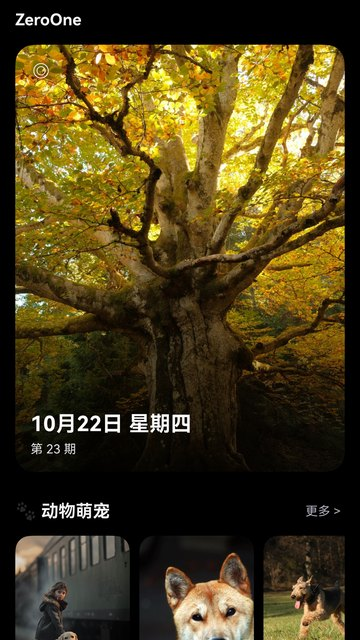
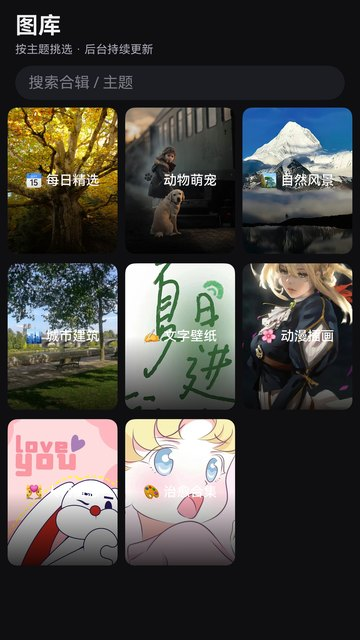
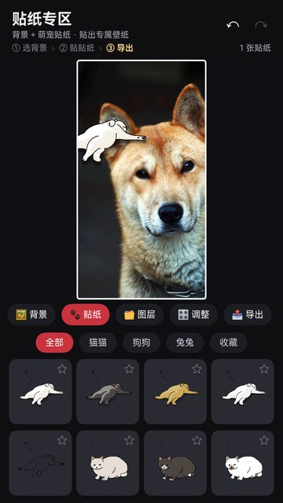

# ZeroOne 壁纸

> 基于 HarmonyOS（ArkTS / ArkUI）原生开发的高清壁纸应用 —— 在线内容 + 本地兜底，支持每日精选、全库搜索、收藏云同步与贴纸编辑，已上架华为应用市场。

<p>
  
  
  
  
</p>

## 截图

| 首页 · 每日精选 | 图库 · 主题合辑 | 全屏预览 | 贴纸专区 |
| :---: | :---: | :---: | :---: |
|  |  |  |  |

## 功能

- **每日精选**：首页大图卡片展示当天人工精选壁纸，按「第 N 期」归档
- **主题合辑**：动物萌宠、自然风景、城市建筑、文字壁纸、动漫插画、治愈系等分类浏览，支持合辑内双列瀑布流
- **全库搜索**：跨在线合辑与本地素材按标题、标签匹配
- **预览与保存**：「铺满」按屏幕比例合成、「适应」保留完整构图，保存到系统相册并给出设置引导
- **收藏**：游客可本机收藏，登录后云同步并与本地收藏合并去重
- **贴纸编辑**：给壁纸叠加文字与贴纸，导出 JPG
- **账号**：浏览免登录，保存需登录；注册 / 登录 / 令牌续期由 `AuthManager` 统一处理
- **离线兜底**：在线接口异常或返回为空时，自动回落随包内置的 307 张本地壁纸，弱网、断网仍可用
- **回访闭环**：公告、意见反馈入口、版本更新提示

## 技术栈

| 层 | 选型 |
|---|---|
| 客户端 | HarmonyOS 6.1.1(24) · ArkTS / ArkUI 声明式开发 · Stage 模型 |
| 状态与存储 | `@ObservedV2` 状态管理 · Preferences 本地持久化 |
| 网络 | `@ohos.net.http` 封装，统一超时、重试与错误码映射 |
| 图片 | 系统 `Image` 组件 · 缩略图与主图分离加载 · 相册写入 `SaveButton` |
| 构建 | hvigor · `assembleApp` 产出 `.app` 提交 AGC |
| 服务端 | NestJS + Prisma + MySQL（独立仓库，未包含在本仓库） |
| 管理后台 | React 18 + Ant Design 5（独立仓库，未包含在本仓库） |

## 项目结构

```
zeroone/
├── AppScope/                       # 应用级配置（包名、版本、图标）
├── entry/                          # 主模块
│   └── src/main/
│       ├── ets/
│       │   ├── common/             # 网络、存储、鉴权、通用组件
│       │   ├── model/              # 数据模型与本地壁纸目录
│       │   ├── pages/              # 首页 / 图库 / 搜索 / 预览 / 贴纸 / 我的 / 登录注册
│       │   └── entryability/       # 应用入口与生命周期
│       └── resources/
│           ├── base/media/         # 本地壁纸主图与缩略图（307 组）
│           └── rawfile/            # 内置动效素材
├── tools/                          # 素材导入、去重、元数据生成等 Python 脚本
├── docs/                           # 设计与验收记录、上架素材
├── legal-site/                     # 隐私政策与用户协议静态页
├── AGENTS.md                       # 给 AI Agent / 协作者的改动约定
├── 截图/                            # 应用市场截图与审核整改证据
└── 软著材料/                        # 软件著作权登记材料
```

客户端共 **76 个 ArkTS 文件 / 约 2.1 万行**。

## 本地运行

**环境**：DevEco Studio（支持 API 24 / HarmonyOS 6.1.1）· Java 17 · Node 18+

1. 用 DevEco Studio 打开本目录，等待 `oh_modules` 同步完成
2. 配置签名：`File > Project Structure > Signing Configs` 勾选 *Automatically generate signature*
   （仓库不包含任何 `.p12` / `.p7b` / `.cer` 与口令）
3. 连接真机或启动模拟器后运行 `entry`

命令行打包（仓库未内置 hvigorw，用 DevEco 自带的那个）：

```bash
# Windows（路径按本机 DevEco 安装位置调整）
HVIGOR="/c/Program Files/Huawei/DevEco Studio/tools/hvigor/bin/hvigorw"
# macOS
# HVIGOR="/Applications/DevEco-Studio.app/Contents/tools/hvigor/bin/hvigorw"

# 调试包
"$HVIGOR" assembleHap --mode module -p product=default -p buildMode=debug --no-daemon

# 上架包（AGC 只接受 .app）
"$HVIGOR" assembleApp --mode module -p product=default -p buildMode=release --no-daemon
```

> 三方应用无法直接设置系统壁纸，因此保存流程统一为「保存到相册 + 引导用户前往图库设置」，代码中不做任何一键设置承诺。

## 版本与上架

| 项 | 值 |
|---|---|
| 应用名称 | ZeroOne 壁纸 |
| 包名 | `com.zeroone.wallpaper` |
| 当前代码版本 | 1.3.0（versionCode 1003000） |
| 上架渠道 | 华为应用市场（1.2.0 起在架，1.3.0 为当前迭代） |
| 软件著作权 | 已登记 |

变更记录见 [CHANGELOG.md](CHANGELOG.md)，当前事实基准见 [CURRENT-STATE.md](CURRENT-STATE.md)。

## 关于开发方式

这个项目是我一个人做的，鸿蒙端、NestJS 后端、React 管理后台三端代码**均由大模型 / AI Agent 协同产出**，我的角色是定义规格与验收：

1. 先把需求写成 PRD，把当前状态固化成 `CURRENT-STATE.md`，让文档成为唯一事实基准
2. 把需求拆成可验收的原子任务，交给 Agent 生成代码
3. 跑构建、跑用例、对照截图验收；失败时带上日志与上下文回退重试
4. 把踩过的坑固化成 `AGENTS.md` 规则与 `tools/` 下的脚本，减少同类返工

所以仓库里 `docs/`、`CHANGELOG.md`、`CURRENT-STATE.md` 的密度高于一般个人项目——它们不是文档洁癖，而是这套协作方式能跑通的前提。给 Agent 的硬性约定整理在 [AGENTS.md](AGENTS.md)：先读哪份文档、什么算改完、哪些东西绝对不能碰。

## 声明

- 本项目为个人作品，代码仅供学习与交流，未经许可请勿用于商业用途
- 壁纸素材来源于公开图库（Unsplash 等），版权归原作者所有；如涉及侵权请提交 Issue，会立即下架相关素材
- 应用名称、图标与界面设计归作者所有

## 反馈

使用中遇到问题或有建议，欢迎提 Issue；应用内「我的 → 意见反馈」也会直达。
